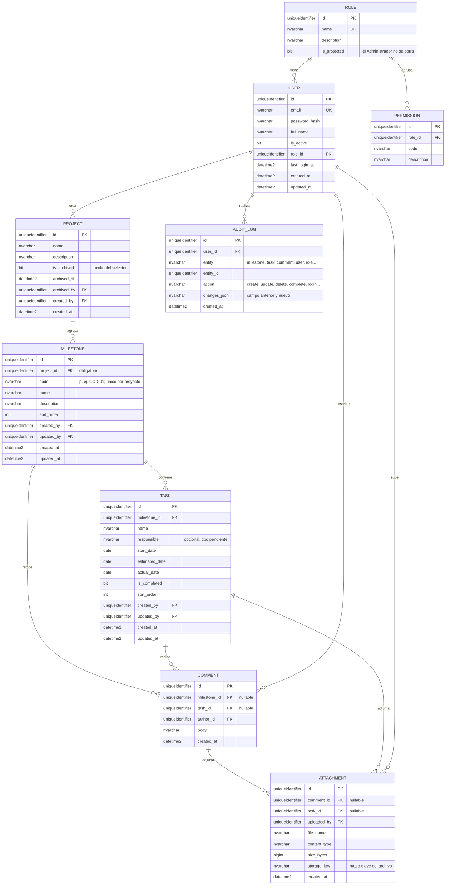

# F01 — Base de datos y backend (NestJS)

**Estado:** Aprobada — solo queda pendiente el despliegue en Azure, que se define cuando el sistema funcione en local (ver [preguntas-abiertas.md](preguntas-abiertas.md)).
**Alcance de este documento:** solo requerimientos y modelo de datos. No se escribe código todavía.

## 1. Objetivo

Incorporar una base de datos SQL Server y un backend en NestJS al tablero de seguimiento, para sustituir el Excel como fuente de datos y permitir autenticación, permisos, edición controlada del avance, comentarios con adjuntos y trazabilidad de quién cambió cada dato.

## 2. Cambio respecto a la versión actual

| Aspecto | Hoy | Con F01 |
|---|---|---|
| Fuente de datos | `seguimiento_salesforce.xlsx` | SQL Server vía API de NestJS |
| Acceso | Público, solo lectura | **Privado**: requiere iniciar sesión; permisos por rol |
| Edición | No existe | Según permisos (ver §6) |
| Usuarios | No existen | Los crea un administrador desde la interfaz |
| Estructura | 6 hitos (H001–H006) con 28 tareas | Un hito por control de cambio; los H001–H006 se descartan |
| Repositorio | Solo frontend | Monorepo con frontend y backend (ver §3) |
| Hosting | GitHub Pages (estático) | Servidor Azure de la empresa (ya existen servidores en funcionamiento). **Por ahora, todo en local.** El frontend deja de depender de Pages |

> Esto reemplaza tres reglas de `context.md`: «sin backend ni base de datos», «solo lectura» y «público». El Excel deja de ser la fuente oficial y pasa a ser solo un medio de importación (§7).

## 3. Arquitectura: monorepo (recomendado)

Es viable y adecuado para un proyecto pequeño: un solo repositorio, un solo historial y cambios de API y pantalla en el mismo commit.

```
/
├─ apps/
│  ├─ web/    ← frontend actual (React + Vite)
│  └─ api/    ← backend NestJS
├─ packages/  ← (opcional) tipos o contratos compartidos
├─ docs/
└─ package.json   ← npm workspaces
```

- **npm workspaces** basta; no hace falta Nx ni Turborepo para este tamaño.
- Node 24 en todo el repositorio.
- **Fase actual: desarrollo local** (API, base de datos de prueba y frontend en la máquina del equipo).
- **Destino:** servidores Azure de la empresa, que ya existen y paga la empresa. El frontend se publicará allí, no en GitHub Pages; el workflow de Pages **se eliminó del repositorio**.
- Detalles de despliegue aún sin definir: tipo de servicio Azure (máquina virtual, App Service…), dominio, HTTPS, y si el frontend lo sirve el mismo servidor que la API (evita problemas de CORS) o uno aparte.
- Mover el frontend a `apps/web` es un cambio de estructura que se hará al implementar, no ahora.
- **Idioma del código:** todo el código fuente, la API, la base de datos y los commits técnicos van en **inglés**. La interfaz sigue en español y la documentación de `docs/` también.

## 4. Módulos

### 4.1 Usuarios (autenticación)
- Los usuarios **no se registran solos**: los crea un administrador desde la interfaz.
- Correo único y contraseña (solo hash). Inicio y cierre de sesión.
- Cada usuario pertenece a **un solo rol**.
- Activo/inactivo; no hay borrado físico.
- **Primera fase: sin «olvidé mi contraseña».** El **administrador administra las contraseñas**: la asigna al crear el usuario y puede asignar una nueva cuando haga falta. **No se obliga a cambiarla** en el primer ingreso. **Largo mínimo de contraseña: 7 caracteres.**
- **Usuario inicial (administrador):** lo crea el equipo de desarrollo mediante una carga inicial (*seed*) de la base. Su correo y contraseña se leen de variables de entorno y no se guardan en el repositorio.

### 4.2 Roles y permisos (simple)

> **Reemplazado por [F02](F02-asignacion-de-proyectos.md):** los permisos Ver/Crear/Modificar/Eliminar ya **no los da el rol** sino la **asignación de cada proyecto a cada usuario**. El rol solo distingue al Administrator (que ve y puede todo) de los demás. Lo que sigue describe el diseño original de F01.
- Un rol agrupa **varios permisos**; relación uno a muchos, tal como se indicó.
- El administrador crea roles y asigna permisos desde la interfaz.
- Los permisos son **básicos, cuatro acciones**: `read` (ver), `create` (crear), `update` (modificar) y `delete` (eliminar).
- Un rol recibe las acciones que el administrador marque; cada fila de `PERMISSION` es una de esas cuatro.
- Las cuatro acciones **valen igual en todo el sistema**: no hay permisos por módulo. Un rol con «modificar» puede modificar hitos, tareas y comentarios por igual.
- La gestión de usuarios, roles, contraseñas, **proyectos** (crear y archivar) e importaciones queda reservada al rol **Administrador**, que es un rol protegido (no se puede borrar ni quedarse sin permisos). Todo ello está confirmado: **solo el Administrador importa archivos Excel**.
- **El Administrador puede hacer todo**: cualquier acción sobre cualquier dato (incluido borrar comentarios y adjuntos ajenos), además de gestionar usuarios, roles, proyectos e importaciones.
- Sin jerarquías ni permisos por registro.

### 4.3 Core (corazón del sitio)
- **Proyecto** (reemplaza al antes llamado «lote»): agrupa hitos y tareas. **Sin fecha de vencimiento.** **Todo hito pertenece a un proyecto.** Puede haber **varios proyectos activos a la vez** y el usuario **selecciona** en la interfaz cuál ver; todos los indicadores (avance, retraso, estados) se calculan por proyecto. **Solo el Administrador crea proyectos.** Un proyecto se puede **archivar** (que es lo que se entiende por «eliminarlo»): deja de aparecer en el selector pero sus datos se conservan; **solo el Administrador puede ver los proyectos archivados** (y reactivarlos). **No existe una vista que sume todos los proyectos.**
- **Hito** = **control de cambio**:
  - código **obligatorio** y único **dentro de su proyecto** (`CC-C` + número, p. ej. `CC-C01`; también `CC-M01`). **No existen hitos sin código** ni hitos «generales» para tareas sin control de cambio;
  - se pueden **crear nuevos hitos a mano** desde la interfaz y **agregarles tareas** en cualquier momento, además de importarlos (§7);
  - nombre y descripción;
  - **fechas y finalización derivadas de sus tareas, no se capturan ni se guardan** (ver «Hito derivado» abajo).
- **Tarea** (pertenece a **un solo** hito):
  - nombre;
  - **responsable**: **opcional** (puede quedar vacío) y de **texto libre** por ahora (no se liga a un usuario del sistema);
  - **fecha de inicio** y **fecha de entrega estimada**, **ambas obligatorias**: sirven para calcular el retraso de la tarea y el retraso global;
  - **botón de check**: al pulsarlo la tarea queda finalizada y se fija su **fecha real de entrega** con el día en que se pulsa. **Cada vez que se marca se fija una fecha nueva**; al desmarcarla se borra. La fecha real no se edita a mano;
  - referencia al código de su hito, que se toma del hito.
- **Comentarios**: lista de comentarios de varios usuarios, en hitos y en tareas, cada uno con autor y fecha. **Los puede borrar su autor y el administrador**; el borrado elimina sus adjuntos y queda en la auditoría. **Los comentarios no se editan** (confirmado): solo se crean y se borran.
- **Adjuntos**: cada comentario puede llevar archivos, sobre todo imágenes. **Las tareas también pueden llevar adjuntos directamente**, no solo dentro de un comentario. Ninguna tarea recibe imágenes desde el Excel: las imágenes se adjuntan **una vez creada la tarea**, a mano o tras importarla.
- **Auditoría**: se registra quién hizo cada cambio (§5).

Siguen siendo **calculados** y no almacenados: avance, fechas y finalización del hito, avance global y días de retraso.

**Retraso de una tarea** (días calendario contra la fecha actual): finalizada → máx(0, real − estimada); no finalizada → días desde el vencimiento o 0; sin fecha estimada, «No calculable» y no suma.

**Retraso del hito y retraso global.** El **retraso del hito es la suma de los días de retraso de sus tareas atrasadas** (confirmado). El **retraso global del proyecto es el acumulado en días de todas sus tareas**. Como las fechas de inicio y estimada son obligatorias, toda tarea es calculable.

**Progreso y finalización del hito.** El hito **no tiene check propio**: su porcentaje de avance (tareas finalizadas ÷ tareas) y su finalización dependen únicamente de sus tareas.

**Estado de la tarea (derivado).** Con la fecha actual:

| Condición | Estado |
|---|---|
| finalizada (check) | Finalizada |
| no finalizada y `start_date` existe y es ≤ hoy | En curso |
| no finalizada y sin `start_date`, o con `start_date` futura | Pendiente |

**Hito derivado de sus tareas** (no tiene check ni fechas propias):

| Dato del hito | Cómo se obtiene |
|---|---|
| Fecha de inicio | La de la **primera tarea** (la fecha de inicio más temprana de sus tareas) |
| Fecha de finalización (real) | La de la **última tarea finalizada**, y solo existe cuando **todas** sus tareas están finalizadas |
| Fecha estimada | La mayor fecha estimada de sus tareas (confirmado) |
| Finalizado | Todas sus tareas finalizadas (y tiene al menos una) |
| En curso | No finalizado y con fecha de inicio ≤ hoy |
| Pendiente | No finalizado y sin fecha de inicio, o con fecha de inicio futura |

Un hito sin tareas no tiene fechas, avance ni estado calculable (se muestra «sin tareas»). Los filtros de estado del tablero usan estos valores calculados.

## 5. Modelo entidad-relación (propuesto)

Tipos pensados para SQL Server: `uniqueidentifier`, `nvarchar`, `bit`, `date`, `datetime2`, `varbinary`.



### Diccionario resumido

| Entidad | Reglas |
|---|---|
| `ROLE` | `name` único. No se elimina si tiene usuarios. |
| `PERMISSION` | `(role_id, code)` único. Se elimina junto con su rol. |
| `USER` | `email` único. Siempre con un rol. Se desactiva, no se borra. Lo crea un administrador. |
| `PROJECT` | Agrupa hitos. **Sin fecha de vencimiento.** Puede haber varios a la vez. Solo el Administrador lo crea. «Eliminar» = **archivar** (`is_archived`): desaparece del selector, no se borra nada y queda en la auditoría. |
| `MILESTONE` | `code` obligatorio y único **por proyecto** (`UNIQUE (project_id, code)`), de modo que el mismo `CC-C01` pueda existir en proyectos distintos; formato habitual `CC-C` + número, sin validación estricta (existen excepciones como `CC-M01`). No guarda fechas ni estado: se derivan de sus tareas. |
| `TASK` | Siempre dentro de **un solo** hito. `start_date` y `estimated_date` **obligatorias**; `estimated_date` ≥ `start_date`. `actual_date` la fija el sistema al marcar el check (nueva fecha en cada marcado) y se borra al desmarcar; solo existe si `is_completed`. |
| `COMMENT` | Pertenece a un hito **o** a una tarea (exactamente uno de los dos, con restricción `CHECK`). Una sola tabla para ambos casos. |
| `ATTACHMENT` | Pertenece a **un comentario o a una tarea** (exactamente uno de los dos, con restricción `CHECK`). El archivo no se guarda en la tabla, solo su referencia (`storage_key`); el archivo físico va en disco (§8). Al borrar el comentario, la tarea o el hito se borran sus adjuntos. |
| `AUDIT_LOG` | Solo se inserta, nunca se edita ni se borra. Registra quién, qué, cuándo y el valor anterior y el nuevo. |

`created_by`/`updated_by` responden «quién fue el último» de forma rápida; `AUDIT_LOG` conserva el historial completo.

**Eliminar un hito:** se elimina junto con sus tareas, comentarios y adjuntos (confirmado). Se pide confirmación y queda registrado en `AUDIT_LOG`.

**Fechas:** son fechas de calendario sin hora, sin zonas horarias (confirmado). Los instantes de auditoría y de creación sí llevan hora (`datetime2`, guardados en UTC y mostrados en hora local).

### Reglas heredadas del tablero (se mantienen)
- Todas las tareas pesan igual dentro de su hito; todos los hitos pesan igual en el avance global.
- Un hito sin tareas muestra avance «no disponible» y no participa en el global.
- El retraso se calcula en días calendario contra la **fecha actual**.
- Las advertencias de coherencia sobre hitos (finalizado con tareas incompletas, fecha real sin finalizar, finalizado sin fecha real) **dejan de existir**, porque el hito se deriva de sus tareas. Se conserva «hito sin tareas». Las de tareas (fecha estimada anterior a la de inicio, fechas vacías) pasan a ser **validaciones que impiden guardar**, no avisos, porque las dos fechas son obligatorias.

## 6. Permisos (propuesta a validar)

El tablero ya no es público: sin sesión no se ve nada.

Los permisos son las cuatro acciones básicas (§4.2). Ejemplo de roles iniciales, que el administrador puede cambiar:

Roles que existen desde el inicio:

| Rol | read | create | update | delete |
|---|---|---|---|---|
| Administrador (protegido) | Sí | Sí | Sí | Sí |
| Revisor (solo lectura) | Sí | No | No | No |

Los demás roles los crea el administrador a conveniencia.

Las acciones son globales (§4.2): «crear» incluye crear hitos, tareas y comentarios. Gestionar usuarios y roles queda solo para el Administrador. Los roles se crean desde la interfaz, así que esto es solo el punto de partida.

## 7. Carga inicial e importación

- **Alta manual:** además de importar, el usuario con permiso de crear puede dar de alta un hito a mano (código obligatorio y único, nombre, descripción) dentro del **proyecto seleccionado** y añadirle tareas. Agregar una tarea a un hito finalizado lo deja de nuevo sin finalizar (regla derivada).
- **Tareas sin control de cambio:** las 5 tareas del análisis que no pertenecen a ningún CC se agrupan en un **hito general con código marcador `CC-GEN`** («Gestión contractual y transversal del CC-001 Rev. 3»), que ya está en la plantilla de importación. Sigue cumpliéndose que **todo hito tiene código**; `CC-GEN` no es un control de cambio del PDF. Este hito es una decisión puntual para estos datos: el sistema no crea hitos generales por sí mismo.
- **Importar Excel:** se mantiene como vía de importación. **La importación no crea proyectos**: carga hitos y tareas en un proyecto ya existente, elegido al importar. El libro actual no tiene fechas de tareas, que son obligatorias, así que **se completarán en el Excel antes de importarlo, con ayuda de Claude**.
- **Proyecto nuevo («sprint grande»):** lo crea el Administrador, sin fecha de vencimiento. Después se llena a mano o con importaciones.
- **Varios proyectos a la vez.** No hay límite de proyectos simultáneos ni un «proyecto activo» único: el usuario elige cuál ver con un selector. Las reglas anteriores de «un solo lote activo» y «el lote se cierra solo / se reabre» **quedan sin efecto**.
- Cada proyecto es independiente: sus hitos, avance y retraso se calculan por separado.
- La interfaz recuerda el último proyecto seleccionado por usuario (preferencia local).
- **Validación al importar:** se **rechazan** los códigos de hito repetidos (dentro del proyecto) y las filas inválidas, con un informe que dice qué fila falla y por qué. **Si hay cualquier error, se cancela toda la importación**: no se guarda nada hasta que se corrija todo el archivo.
- **Plantilla de importación (una hoja, una fila por tarea):** `CodigoHito`, `NombreHito`, `DescripcionHito`, `Tarea`, `Responsable` (opcional), `FechaInicio`, `FechaEstimada`. El proyecto se elige en la pantalla, no en el archivo. **El Excel no trae adjuntos ni imágenes**; se agregan después. Cuando el Excel esté listo, con las fechas completadas, **se cargará** (el nombre del proyecto que lo recibe se define entonces).
- Una fila es inválida, entre otras causas, si le falta el código del hito, la tarea, la fecha de inicio o la estimada, si la estimada es anterior a la de inicio, o si una fecha no se puede leer.
- Cada importación queda registrada en `AUDIT_LOG` con su autor.
- **Mapeo desde el Excel:** se usa cada código `CC-…` como hito. Cuando la celda cita varios códigos, **se toma solo el primero** (confirmado): una tarea nunca pertenece a más de un hito. Los campos `TipoTarea`, `FuenteHallazgo`, el resto de `ControlCambioOrigen` y `Observaciones` se descartan. `Responsable` **se conserva** como campo opcional de la tarea.

## 8. Adjuntos de comentarios

- Se pueden subir archivos en un comentario y **directamente en una tarea**, sobre todo **imágenes**. Ambos casos tienen los mismos límites y la misma vista previa. Subir un adjunto a una tarea requiere el permiso `update`. **Lo puede borrar el usuario que lo subió y el Administrador.** Los límites son los mismos que en comentarios: 5 MB por archivo y **máximo 5 por tarea**. **Los hitos no llevan adjuntos directos**, solo a través de comentarios.
- **Límites (confirmados):** tipos permitidos PNG, JPG, WebP y PDF; máximo 5 MB por archivo; máximo 5 archivos por comentario.
- Validar tipo real del archivo (no solo extensión) y no ejecutar nunca lo subido.
- Descarga solo con sesión y permiso de lectura.
- Vista previa de imágenes en el comentario.
- **Almacenamiento: disco del servidor.** La carpeta se configura por variable de entorno, fuera del código y de lo que sirve el frontend; `storage_key` guarda la ruta relativa. Los archivos se descargan solo a través de la API con sesión y nunca como archivos estáticos.
- Al borrar un comentario, una tarea o un hito se borran también sus archivos del disco.
- Respaldo de esa carpeta junto con la base: pendiente con el equipo de servidores.

## 9. Requisitos no funcionales (propuesta)

- Contraseñas con hash robusto; nunca en texto plano ni en registros.
- Autenticación por token con expiración; todas las rutas protegidas por permiso, incluida la descarga de adjuntos.
- Validación de entradas y mensajes de error comprensibles.
- Auditoría de cambios (§5).
- Migraciones versionadas para SQL Server.
- Credenciales y cadenas de conexión solo en variables de entorno; nunca en el repositorio. (Las credenciales de la base de prueba las comparte el usuario más adelante.)
- Respaldos de base de datos y adjuntos: pendiente de definir con el equipo que administra los servidores Azure.
- Configuración por entorno (local ahora, Azure después) mediante variables de entorno, sin cambiar código.

## 10. Fuera de alcance por ahora

Notificaciones, flujos de aprobación y reportes exportables. «Eso por el momento», según lo indicado.

## 11. Criterios de aceptación (borrador)

1. Sin sesión no se muestra ningún dato; con credenciales válidas se inicia sesión y con inválidas hay un error claro.
2. Un administrador crea usuarios y roles, y marca para cada rol las acciones ver, crear, modificar y eliminar. El usuario administrador inicial existe tras la carga inicial.
3. Un usuario sin el permiso necesario no puede ejecutar la acción y recibe un rechazo explícito.
4. Se puede crear un hito con su código dentro de un proyecto, agregarle tareas con fecha de inicio y estimada, y finalizarlas con el botón de check. El hito toma su inicio de la primera tarea y se finaliza solo al terminar todas, con la fecha de la última.
4b. Pueden existir varios proyectos a la vez; el usuario selecciona cuál ver y los indicadores corresponden solo a ese proyecto.
4c. El retraso de cada tarea se calcula con sus fechas y el retraso global es la suma en días del retraso de todas las tareas.
4d. Marcar una tarea fija la fecha real de ese día; desmarcarla y volver a marcarla fija una fecha nueva.
5. Avance, retrasos y avisos de coherencia salen iguales que en el tablero actual para los mismos datos.
6. Se agregan comentarios a hitos y tareas; se ven con autor y fecha; se pueden adjuntar imágenes y verlas, tanto en comentarios como directamente en una tarea ya creada.
7. Cada cambio queda registrado con su autor, fecha y valores anterior y nuevo.
8. Eliminar un hito elimina sus tareas, comentarios y adjuntos tras confirmación.
9. El Administrador crea un proyecto sin fecha de vencimiento, lo archiva para ocultarlo del selector, e importa un Excel en un proyecto existente; los códigos repetidos y las filas inválidas se rechazan con un informe.
10. La base se crea desde migraciones en una instancia vacía de SQL Server.
