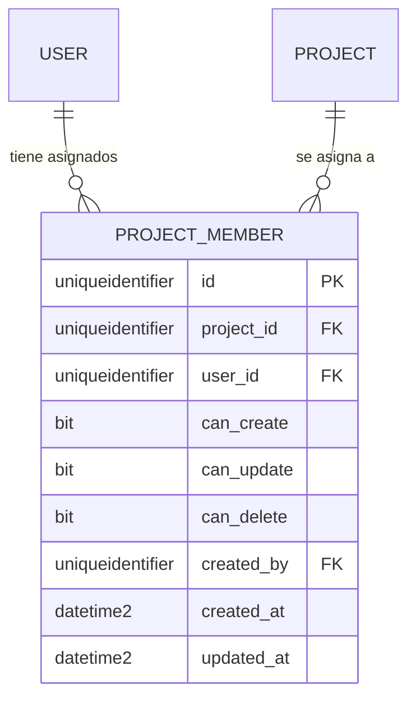

# F02 — Asignación de proyectos a usuarios, con permisos por proyecto

**Estado:** implementado en el código; **falta crear la tabla `project_members`** en la base (requiere un usuario con permisos de DDL: ver el script de la §5).

## 1. Qué cambia

Hasta F01, los permisos (Ver, Crear, Modificar, Eliminar) los daba el **rol** y valían igual en todos los proyectos. Con F02, un administrador **asigna proyectos a cada usuario** desde la pantalla de edición de usuarios, y para cada proyecto asignado decide qué puede hacer.

## 2. Decisiones (confirmadas)

| Tema | Decisión |
|---|---|
| Rol y permisos | **La asignación manda.** Para quien no es administrador, los permisos salen solo de lo asignado en cada proyecto. Los permisos del rol **dejan de usarse**; el rol solo distingue al Administrator de los demás |
| Usuario sin proyectos asignados | **No ve ningún proyecto** |
| Alcance de los permisos | **Al contenido del proyecto**: hitos, tareas, comentarios y adjuntos. Crear, renombrar, archivar proyectos, importar Excel y gestionar usuarios y roles siguen siendo **solo del administrador** |
| Administrator | Ve y puede todo en todos los proyectos; **no necesita asignación** (y no se le puede asignar nada) |

## 3. Reglas

| Permiso | Qué permite dentro del proyecto asignado |
|---|---|
| **Ver** | Siempre incluido al asignar el proyecto: ver el tablero, los hitos, las tareas, los comentarios y los adjuntos |
| **Crear** | Crear hitos y tareas; escribir comentarios |
| **Modificar** | Editar hitos y tareas, marcar o reabrir tareas (el botón de check) y adjuntar archivos a tareas |
| **Eliminar** | Eliminar hitos y tareas (con sus comentarios y adjuntos) |

- Cada permiso es independiente de los otros, salvo **Ver**, que no se puede quitar (quitarlo es quitar la asignación).
- **Borrar un comentario** sigue siendo de su autor o de un administrador, y **borrar un adjunto** de quien lo subió o de un administrador. No exigen el permiso Eliminar; sí exigen tener el proyecto asignado.
- Un proyecto **no asignado** se comporta como si no existiera (la API responde «no encontrado»), no como «prohibido»: no revela que existe.
- Un proyecto **archivado** sigue siendo invisible para quien no es administrador, aunque esté asignado. Las asignaciones a proyectos archivados se conservan y vuelven a funcionar al reactivarlo; no se pueden crear ni cambiar mientras está archivado.
- Una cuenta **desactivada** pierde todo acceso, tenga las asignaciones que tenga.
- Quitar el rol Administrator a un usuario lo deja **sin proyectos** hasta que se le asignen.
- Cada cambio de asignaciones queda en la auditoría (`projects_assigned`).

## 4. Modelo de datos y API

Nueva tabla `project_members` (una fila por usuario y proyecto):



`UNIQUE (project_id, user_id)`. «Ver» no se guarda: asignar es ver.

| Ruta (`/api`) | Acceso | Qué hace |
|---|---|---|
| `GET /users/:userId/projects` | Solo Administrator | Proyectos asignados al usuario y sus permisos |
| `PUT /users/:userId/projects` | Solo Administrator | **Reemplaza** todas las asignaciones del usuario por la lista enviada (`{ "assignments": [{ "projectId", "create", "update", "delete" }] }`), en una transacción |
| `GET /projects` | Sesión | Administrador: todos (`?includeArchived=true` para los archivados). Los demás: solo los asignados, cada uno con `permissions` |
| `GET /projects/:id/dashboard` | Con el proyecto asignado | Añade `permissions` con lo que el usuario puede hacer |

Las rutas de hitos, tareas, comentarios y adjuntos ya no consultan los permisos del rol: comprueban la asignación del proyecto al que pertenece cada recurso.

## 5. Script de creación de la tabla (para quien administra la base)

Ejecutar con la base seleccionada. Es compatible con SQL Server 2012. Se validó con el analizador de SQL Server sin errores de sintaxis.

```sql
USE fw_project;
GO

CREATE TABLE project_members (
  id UNIQUEIDENTIFIER NOT NULL CONSTRAINT DF_project_members_id DEFAULT NEWSEQUENTIALID(),
  project_id UNIQUEIDENTIFIER NOT NULL,
  user_id UNIQUEIDENTIFIER NOT NULL,
  can_create BIT NOT NULL CONSTRAINT DF_project_members_can_create DEFAULT 0,
  can_update BIT NOT NULL CONSTRAINT DF_project_members_can_update DEFAULT 0,
  can_delete BIT NOT NULL CONSTRAINT DF_project_members_can_delete DEFAULT 0,
  created_by UNIQUEIDENTIFIER NOT NULL,
  created_at DATETIME2(3) NOT NULL CONSTRAINT DF_project_members_created_at DEFAULT SYSUTCDATETIME(),
  updated_at DATETIME2(3) NOT NULL CONSTRAINT DF_project_members_updated_at DEFAULT SYSUTCDATETIME(),
  CONSTRAINT PK_project_members PRIMARY KEY (id),
  CONSTRAINT UQ_project_members_project_user UNIQUE (project_id, user_id),
  CONSTRAINT FK_project_members_project FOREIGN KEY (project_id) REFERENCES projects (id),
  CONSTRAINT FK_project_members_user FOREIGN KEY (user_id) REFERENCES users (id),
  CONSTRAINT FK_project_members_created_by FOREIGN KEY (created_by) REFERENCES users (id)
);
GO

CREATE INDEX IX_project_members_user ON project_members (user_id);
GO
```

**Si la tabla `migrations` ya existe** (solo si se registró la migración inicial), registrar esta migración para que las herramientas no intenten crearla de nuevo:

```sql
USE fw_project;
GO

IF OBJECT_ID(N'dbo.migrations', N'U') IS NOT NULL
   AND NOT EXISTS (SELECT 1 FROM migrations WHERE [timestamp] = 1792605600000)
  INSERT INTO migrations ([timestamp], name) VALUES (1792605600000, 'AddProjectMembers1792605600000');
GO
```

**Verificación:**

```sql
SELECT name FROM sys.tables WHERE name = 'project_members';
SELECT COUNT(*) AS asignaciones FROM project_members;   -- 0 al inicio
```

**Reversión** (solo en pruebas; borra las asignaciones):

```sql
USE fw_project;
GO
IF OBJECT_ID(N'dbo.project_members', N'U') IS NOT NULL DROP TABLE dbo.project_members;
IF OBJECT_ID(N'dbo.migrations', N'U') IS NOT NULL DELETE FROM migrations WHERE [timestamp] = 1792605600000;
GO
```

## 6. Efecto sobre los usuarios existentes

Al activarse F02, **los usuarios que no son administradores pierden el acceso a todos los proyectos hasta que se les asignen**. Los administradores no se ven afectados. Orden recomendado: crear la tabla, y entonces asignar proyectos desde **Usuarios → Editar**.
